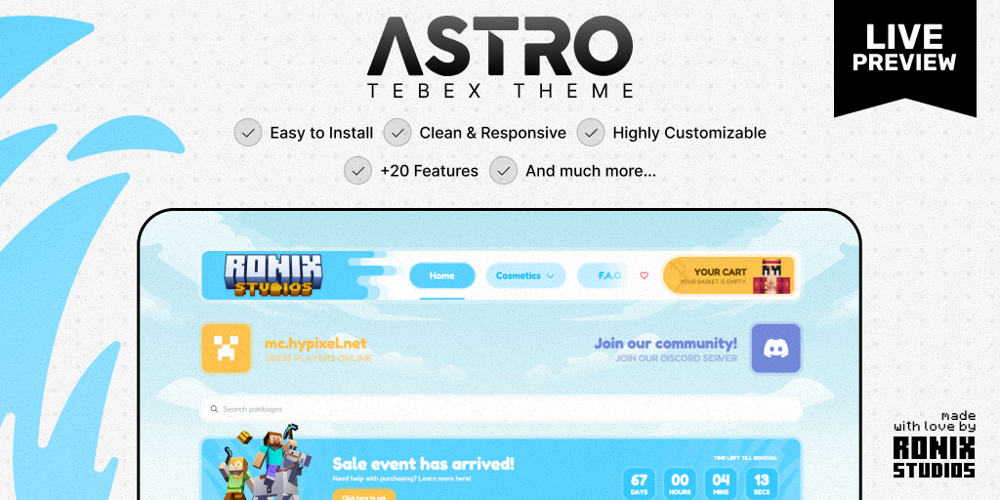

<Note>
  You must have a **Tebex Plus** plan. If you do not have a **Tebex Plus** plan, you will **not** be able to install the theme.
</Note>

<Frame>
  
</Frame>

<Card title="Click here to see live preview!" icon="eye" horizontal href="https://ronix-tebex.vercel.app/astro/">
</Card>

# Meet your needs with a single theme!

Most of Astro's features come with the theme; only the rank table and removing the Ronix Studios credit are paid add-ons.

# Requirements

- A **Tebex Plus** plan.
- Tebex's Legacy Webstore (in the panel, **Storefront → Open Editor**). The theme is a template for it; it does not work with the storefronts of Tebex's newer drag-and-drop builder (**Create Storefront**).

# **In this wiki**

<CardGroup cols="2">
  <Card title="See all features" horizontal href="features" cta="Click here to see">
  </Card>

  <Card title="Installation" horizontal href="installation" cta="Click here to see">
  </Card>

  <Card title="Tebex theme settings" horizontal href="tebex-settings" cta="Click here to see">
  </Card>

  <Card title="How to setup license" horizontal href="license" cta="Click here to see">
  </Card>

  <Card title={"Questions & Fixes"} horizontal href="questions-and-fixes" cta="Click here to see">
  </Card>

  <Card title="Changelogs" horizontal href="changelogs" cta="Click here to see">
  </Card>
</CardGroup>

### <Icon icon="store" size="23" />  Store Links

<CardGroup cols="4">
  <Card title="BuiltByBit" icon="external-link" href="" cta="Buy Now">
  </Card>

  <Card title="VoxelShop" icon="external-link" href="" cta="Buy Now">
  </Card>
</CardGroup>
