Tebex shows these settings on the **Appearance** page of your Legacy Webstore (**Storefront → Open Editor → Appearance**).

<Tabs>
  <Tab title="Global Settings">
    | **Setting** | **Default** | **What it does** |
    | --- | --- | --- |
    | Server Type | `Minecraft` | The game your store sells for. Minecraft-only parts (player heads, the Java / Bedrock login, the block icon) appear only for Minecraft. Options: `Minecraft`, `Rust`, `Unturned`, `FiveM`. |
    | Bedrock | `Off` | Show the Java / Bedrock tabs on the login modal. Options: `On`, `Off`. |
    | Bedrock Prefix | `.` | What your server's Floodgate puts in front of Bedrock players' names (username-prefix in its config; a dot unless you changed it). Bedrock players get it in front of their name when they log in, so their packages reach them in-game; spaces in their gamertag become underscores, as Floodgate does. Choose None if Floodgate adds no prefix. Minecraft only. Options: `.`, `*`, `_`, `None`. |
    | Developer Mode | `Off` | Enable to edit the rank table in place. Options: `On`, `Off`. |
    | Currencies | — | Currency codes offered in the currency selector, comma-separated (e.g. USD, EUR, TRY). Leave empty for the default list. The store currency is always offered. |
  </Tab>
  <Tab title="Style">
    | **Setting** | **Default** | **What it does** |
    | --- | --- | --- |
    | Color Preset | `Default` | A ready-made main colour. A Primary Color set by hand takes precedence. Options: `Default`, `Mint`, `Coral`, `Lilac`, `Orange`, `Grass`. |
    | Primary Color | theme colour | Buttons, headings and accents. Set to black (#000000) to keep the theme's sky blue. |
    | Card Color | theme colour | Background of cards and panels. Set to black (#000000) to keep white. |
    | Background Color | theme colour | Page background below the sky. Set to black (#000000) to keep the theme default. |
    | Sky Image | — | Replaces the clouds at the top of the page. Leave empty for the theme's clouds. |
  </Tab>
  <Tab title="SEO">
    | **Setting** | **Default** | **What it does** |
    | --- | --- | --- |
    | Preview Image | — | Image shown when the store link is shared. |
    | Theme Color | `#5BD3FF` | Colour of link previews (such as Discord embeds) and of the browser bar on phones, as a HEX code. |
    | Site Description | — | Description used by search engines and link previews. |
  </Tab>
  <Tab title="Header">
    <Frame>
      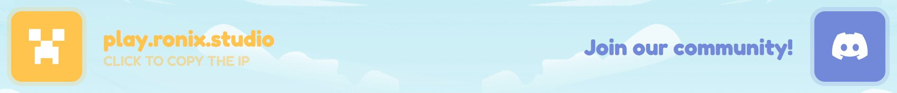
    </Frame>

    The server bar under the navbar: the server address and the Discord block.

    | **Setting** | **Default** | **What it does** |
    | --- | --- | --- |
    | Server IP | — | Shown in the server bar and the footer. Clicking it opens the join dialog. Leave empty to hide. |
    | Server Hover Text | `Click to copy the IP` | Replaces the player count while the server IP is hovered. |
    | Discord Invite Link | — | Leave empty to hide the Discord block. |
    | Discord Server ID | — | Needed for the member count. The server's widget must be enabled in Discord. |
    | Discord Title | `Join our community!` | Heading of the Discord block in the header. |
    | Discord Hover Text | `Join our Discord server` | Replaces the member count while the Discord block is hovered. |
  </Tab>
  <Tab title="Navigation">
    <Frame>
      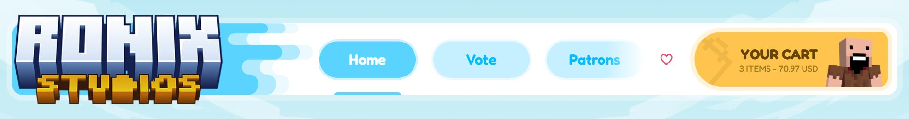
    </Frame>

    The navbar: Home, your links and your CMS pages.

    | **Setting** | **Default** | **What it does** |
    | --- | --- | --- |
    | Navbar Links | — | Extra links in the navbar, after the categories, one per line as "Label \| URL" (for example "Rules \| /rules" or "Website \| [https://example.com](https://example.com)"). Your CMS pages follow them. Add an image URL as a third part for an icon ("Discord \| [https://discord.gg/abc](https://discord.gg/abc) \| [https://example.com/discord.png](https://example.com/discord.png)"). |
    | Navbar Home Image | — | Icon shown next to the Home entry in the navbar. |
    | Page Icons | — | Icons for your CMS pages in the navbar, one per line as "page \| image URL": the page's address ("faq" for /faq) or its title, then the image's URL (for example "faq \| [https://example.com/faq.png](https://example.com/faq.png)"). |
  </Tab>
  <Tab title={"Categories & Packages"}>
    <Frame>
      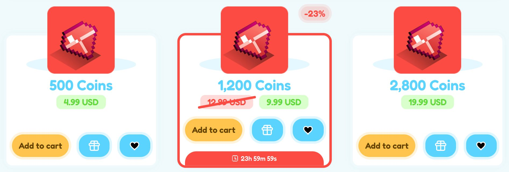
    </Frame>

    Package cards on a category page.

    | **Setting** | **Default** | **What it does** |
    | --- | --- | --- |
    | Home Page Categories | `On` | Show a tile for every category on the home page. Options: `On`, `Off`. |
    | Subcategories | `Category page` | Where child categories appear: as tiles on their parent category page, or as a dropdown in the navbar. Options: `Category page`, `Navbar`. |
    | Group Packages by Quantity | `Off` | Packages named like "1 Key", "5 Keys", "10 Keys" share one card with a quantity switch. Options: `On`, `Off`. |
    | Package Search | `On` | A search box for every package in the store. The first search reads your category pages, so it can take a moment on a big store. Options: `On`, `Off`. |
    | Wishlist | `On` | A heart on each package saves it to a wishlist kept in the visitor's browser; the Wishlist button lists the saved packages, with their price and an add-to-basket button. Options: `On`, `Off`. |
    | Image Zoom | `On` | Images in a package's description open full screen when clicked (small icons are enlarged without blurring). Options: `On`, `Off`. |
    | Sticky Buy Bar | `On` | On phones, a package's price and its add-to-basket button stay at the bottom of the screen while the description scrolls. Options: `On`, `Off`. |
  </Tab>
  <Tab title="Reviews">
    <Frame>
      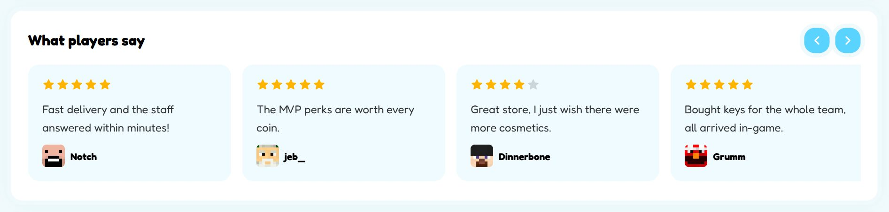
    </Frame>

    The reviews on the home page.

    | **Setting** | **Default** | **What it does** |
    | --- | --- | --- |
    | Reviews | `Off` | Show the reviews written below on the home page. Options: `On`, `Off`. |
    | Reviews Title | — | The heading above the reviews. Empty: "What players say". |
    | Review List | — | One review per line: the player's name, the stars (1 to 5) and the text, separated by "\|". For example: Notch \| 5 \| Fast delivery and friendly staff! A line with only a name and a text gets 5 stars. Do not use "\|" in the text. |
  </Tab>
  <Tab title="Team">
    <Frame>
      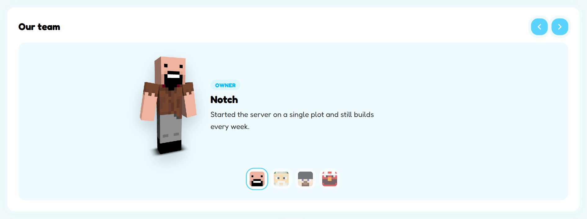
    </Frame>

    The team on the home page.

    | **Setting** | **Default** | **What it does** |
    | --- | --- | --- |
    | Team | `Off` | Show your team on the home page, under the reviews: one person at a time with their skin, and their heads to switch between them. Options: `On`, `Off`. |
    | Team Title | — | The heading over the team. Empty: "Our team". |
    | Team Members | — | One person per line: their name, their role and a line about them, separated by "\|", for example "itsSycho \| Manager \| Runs the team and designs the builds." Do not use "\|" in the text. |
  </Tab>
  <Tab title="Announcement">
    <Frame>
      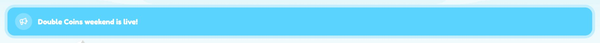
    </Frame>

    The announcement bar.

    | **Setting** | **Default** | **What it does** |
    | --- | --- | --- |
    | Announcement Text | — | A slim bar above the sale banner. Leave empty to hide it. |
    | Announcement Link | — | Where the bar links to. Leave empty for plain text. |
    | Open Link In | `self` | self opens the link in the same tab, new in a new tab. Options: `self`, `new`. |
  </Tab>
  <Tab title="Sale Image">
    <Frame>
      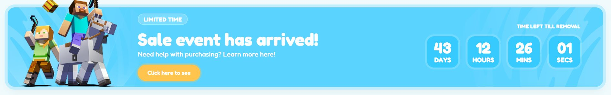
    </Frame>

    The sale banner.

    | **Setting** | **Default** | **What it does** |
    | --- | --- | --- |
    | Show Sale Banner | `Off` | Banner under the server bar on every page. Options: `On`, `Off`. |
    | Image | — | Artwork on the left of the banner. Leave empty for the theme's characters. |
    | Tag Text | — | Small label above the sale headline, for example "Limited Time". Leave empty to hide it. |
    | Sale Title | `Sale event has arrived!` | Headline of the sale banner. |
    | Sale Description | `Need help with purchasing? Learn more here!` | Text under the headline. Leave empty to hide it. |
    | Sale Button Text | `Click here to see` | Label of the banner's button. |
    | Sale Link | `/` | Where the banner and its button link to. |
    | Countdown Label | Time left till removal | Small label above the countdown. |
    | Sale Ends | — | Format: MM.DD.YYYY HH:MM:SS. The countdown is hidden when empty. |
  </Tab>
  <Tab title="Modules">
    <Frame>
      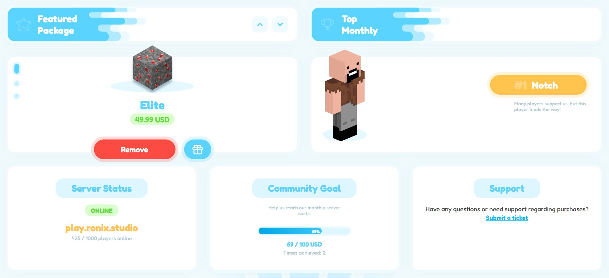
    </Frame>

    The modules in a row under the page (Module Position: Bottom).

    | **Setting** | **Default** | **What it does** |
    | --- | --- | --- |
    | Module Position | `Bottom` | Where the modules (featured package, top donator, payments, gift card, goals) sit on wide screens: in a row below the page, or in a sidebar on the left or right. Phones and tablets always show them below. Options: `Bottom`, `Left`, `Right`. |
    | Top Donator Text | `Many players support us, but this player leads the way!` | Line under the top donator's name. |
    | Purchase Goal Description | `Help us reach this month's goal.` | Line under the purchase goal title. |
    | Purchase Notifications | `Off` | Show the latest purchases from the Recent Payments module one at a time in a corner of the page. Needs that module; not shown on phones. Options: `On`, `Off`. |
  </Tab>
  <Tab title="Vote">
    <Frame>
      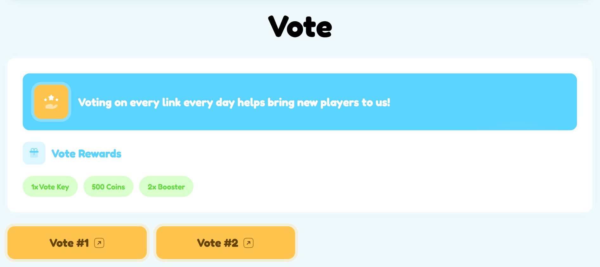
    </Frame>

    The vote page: its text, the rewards and the voting site links.

    | **Setting** | **Default** | **What it does** |
    | --- | --- | --- |
    | Vote Text | `Voting on every link every day helps bring new players to us!` | Shown on the page with the slug "vote". |
    | Vote Rewards | — | One reward per line. |
    | Vote Links | — | One link per line. |
  </Tab>
  <Tab title="Patrons">
    <Frame>
      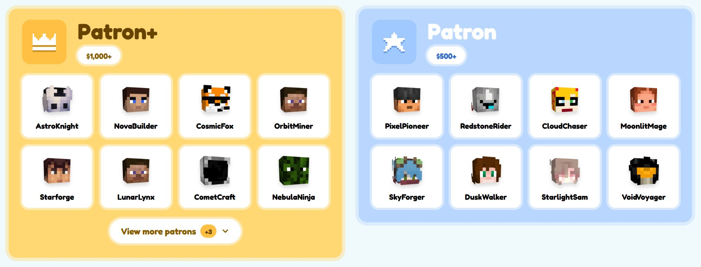
    </Frame>

    The patron tiers on the Patrons page.

    | **Setting** | **Default** | **What it does** |
    | --- | --- | --- |
    | Subtitle | — | Shown under the title of the page with the slug "patrons". Write the rest of the intro (headings, text, a bullet list of rewards) in that page's content. |
    | Tier 1 Name | — | Leave empty to hide this tier. |
    | Tier 1 Threshold | — | For example: \$1,000+ |
    | Tier 1 Badge | — | Image shown next to the tier name. |
    | Tier 1 Players | — | One player name per line. |
    | Tier 2 Name | — | Leave empty to hide this tier. |
    | Tier 2 Threshold | — | For example: \$500+ |
    | Tier 2 Badge | — | Image shown next to the tier name. |
    | Tier 2 Players | — | One player name per line. |
    | Tier 3 Name | — | Leave empty to hide this tier. |
    | Tier 3 Threshold | — | For example: \$250+ |
    | Tier 3 Badge | — | Image shown next to the tier name. |
    | Tier 3 Players | — | One player name per line. |
  </Tab>
  <Tab title="Footer">
    <Frame>
      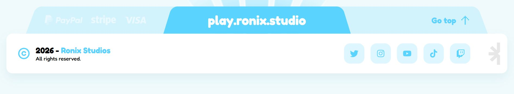
    </Frame>

    The footer, with the payment logos and the copyright line.

    | **Setting** | **Default** | **What it does** |
    | --- | --- | --- |
    | Copyright Line | `All rights reserved. We are not affiliated with Mojang AB.` | Line shown under the copyright notice in the footer. |
    | Payment Logos | `On` | PayPal, Stripe and Visa logos in the footer. Options: `On`, `Off`. |
    | Social Links | `Off` | Show the links below in the footer. Options: `On`, `Off`. |
  </Tab>
  <Tab title="Social Links">
    <Frame>
      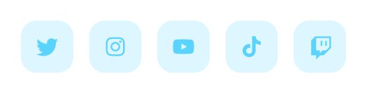
    </Frame>

    The social links in the footer.

    | **Setting** | **Default** | **What it does** |
    | --- | --- | --- |
    | Facebook | — | Profile link. Leave empty to hide the icon. |
    | X / Twitter | — | Profile link. Leave empty to hide the icon. |
    | Instagram | — | Profile link. Leave empty to hide the icon. |
    | YouTube | — | Channel link. Leave empty to hide the icon. |
    | TikTok | — | Profile link. Leave empty to hide the icon. |
    | Twitch | — | Channel link. Leave empty to hide the icon. |
    | LinkedIn | — | Profile link. Leave empty to hide the icon. |
    | GitHub | — | Profile link. Leave empty to hide the icon. |
  </Tab>
  <Tab title="Rank Table">
    <Frame>
      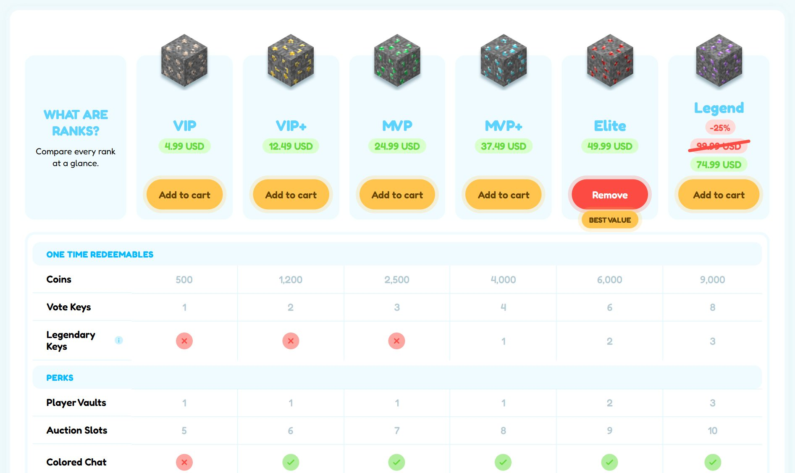
    </Frame>

    The rank table, opened on a ranks category.

    | **Setting** | **Default** | **What it does** |
    | --- | --- | --- |
    | Rank Table | `Off` | Offer a comparison table on categories that have one configured. Options: `On`, `Off`. |
    | Default Perk Value | `False` | What an unset perk cell shows. Options: `True`, `False`. |
    | Banner Text | `Still not sure what to get?` | Text on the banner that opens the comparison table. |
    | Table Title | — | Title of the info card in the comparison table's corner. Leave empty (with no description) to hide the card. |
    | Table Description | — | Description shown under the table title. |
    | Highlighted Package ID | — | ID of the package to badge as the best value in the comparison table. |
    | Highlight Text | `Best Value` | Text of the badge on the highlighted package. |
  </Tab>
</Tabs>

### <Icon icon="store" size="23" />  Store Links

<CardGroup cols="4">
  <Card title="BuiltByBit" icon="external-link" href="" cta="Buy Now">
  </Card>

  <Card title="VoxelShop" icon="external-link" href="" cta="Buy Now">
  </Card>
</CardGroup>
