<Tabs>
  <Tab title="Global Settings">
    <Frame>
      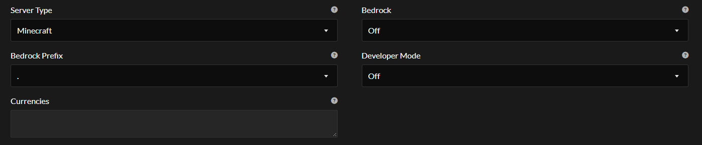
    </Frame>

    From the General settings tab, you can select the server type, enable/disable bedrock login and specify its prefix, set currencies, and enable developer mode.

    <Note>
      You need to open Developer Mode to set Rank Table.
    </Note>
  </Tab>
  <Tab title="Header">
    <Frame>
      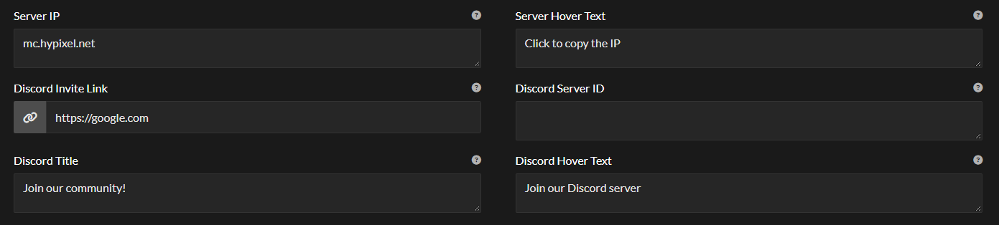
    </Frame>

    In the header settings, you can set your server's IP address, your Discord server ID, and your join address.
  </Tab>
  <Tab title="Navigation">
    <Frame>
      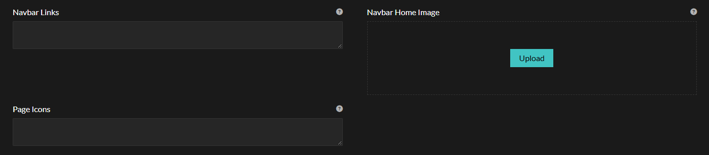
    </Frame>
  </Tab>
  <Tab title={"Categories & Packages"}>
    <Frame>
      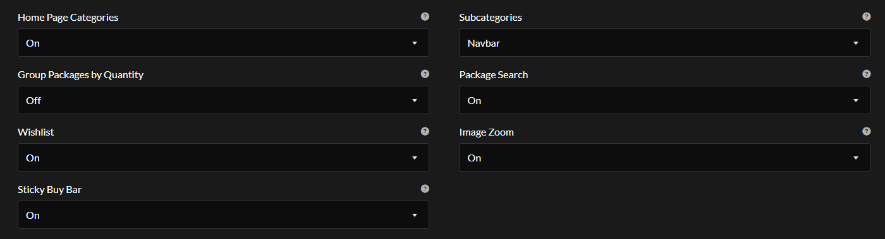
    </Frame>
  </Tab>
  <Tab title="Reviews">
    <Frame>
      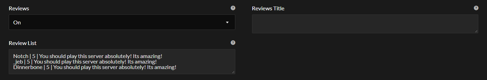
    </Frame>
  </Tab>
  <Tab title="Team">
    <Frame>
      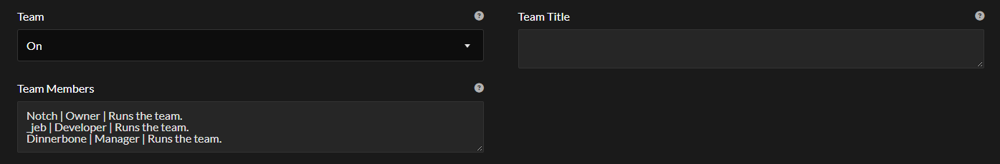
    </Frame>
  </Tab>
  <Tab title="Announcement">
    <Frame>
      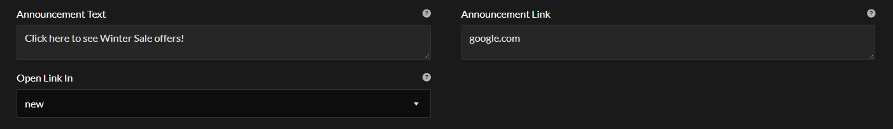
    </Frame>
  </Tab>
  <Tab title="Sale Event">
    <Frame>
      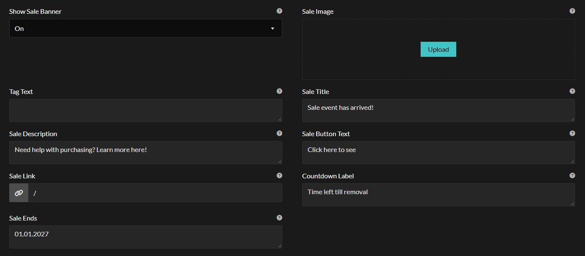
    </Frame>
  </Tab>
  <Tab title="Modules">
    <Frame>
      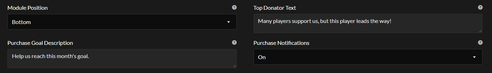
    </Frame>
  </Tab>
  <Tab title="Vote">
    <Frame>
      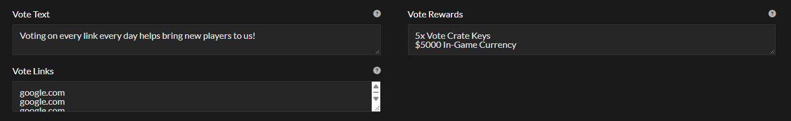
    </Frame>
  </Tab>
  <Tab title="Patrons">
    <Frame>
      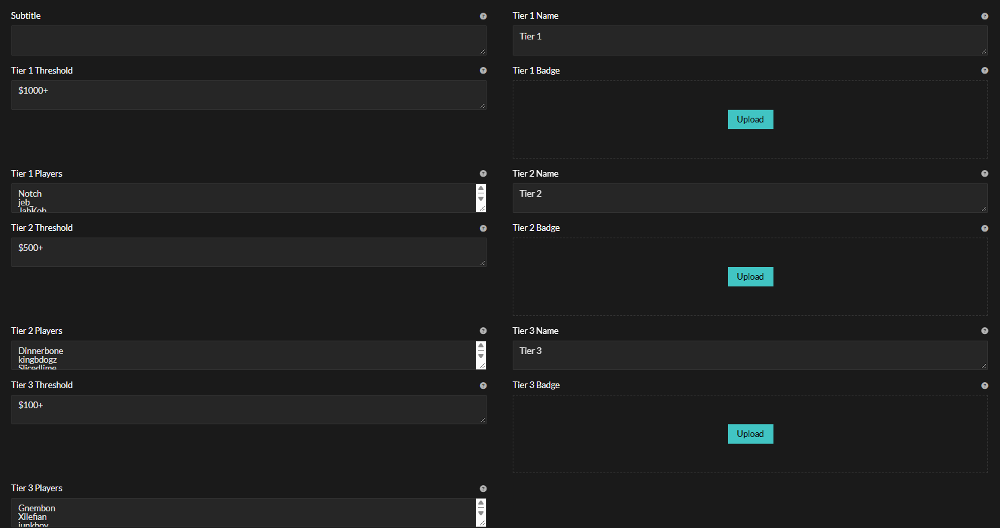
    </Frame>
  </Tab>
  <Tab title="Footer">
    <Frame>
      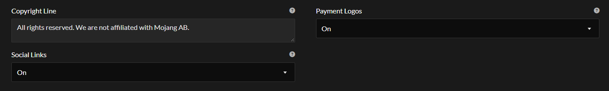
    </Frame>
  </Tab>
  <Tab title="Social Links">
    <Frame>
      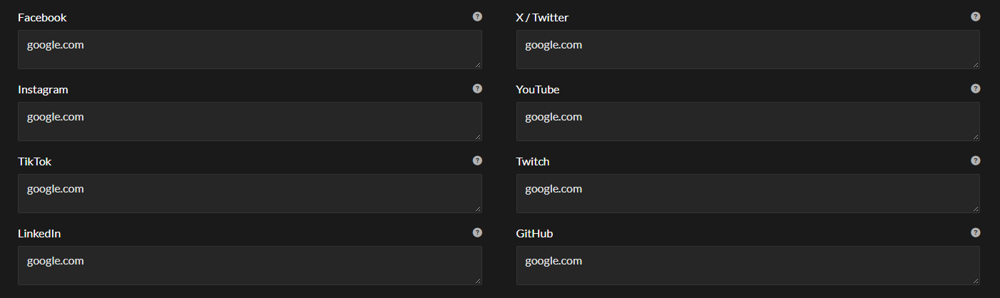
    </Frame>
  </Tab>
  <Tab title="Rank Table">
    <Frame>
      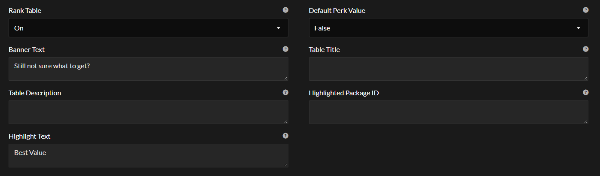
    </Frame>
  </Tab>
</Tabs>

### <Icon icon="store" size="23" />  Store Links

<CardGroup cols="4">
  <Card title="BuiltByBit" icon="external-link" href="" cta="Buy Now">
  </Card>

  <Card title="VoxelShop" icon="external-link" href="" cta="Buy Now">
  </Card>
</CardGroup>
